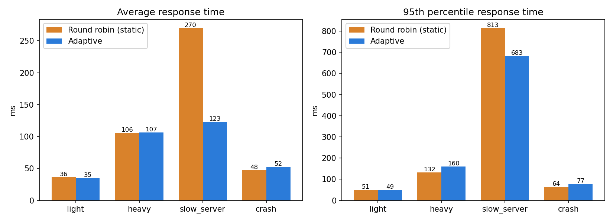
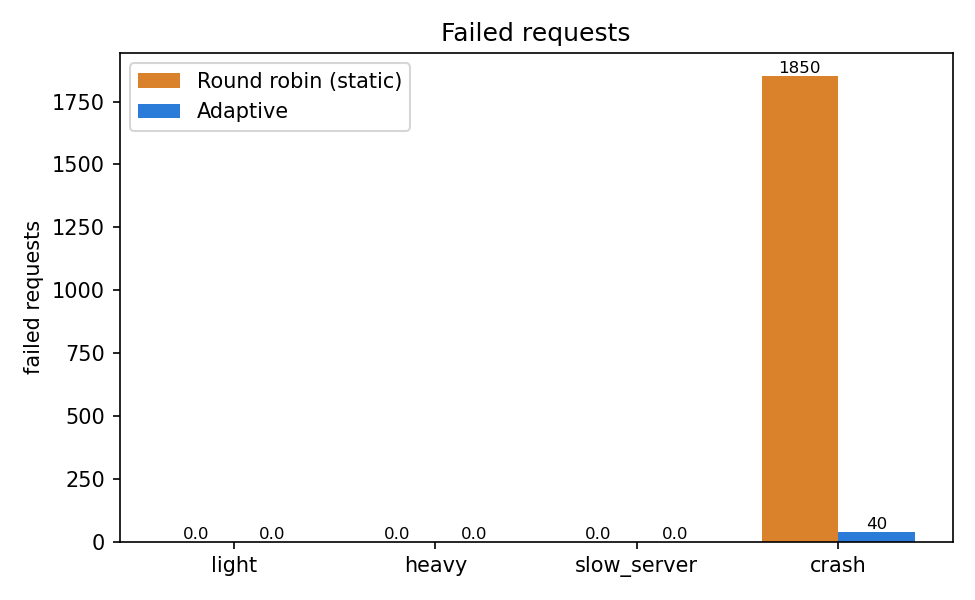
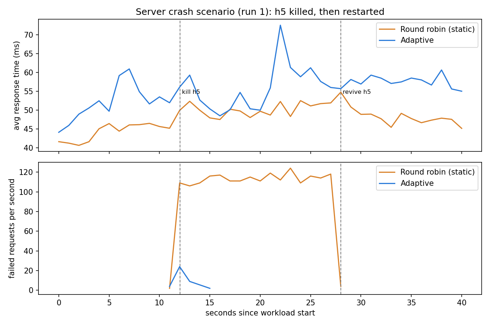
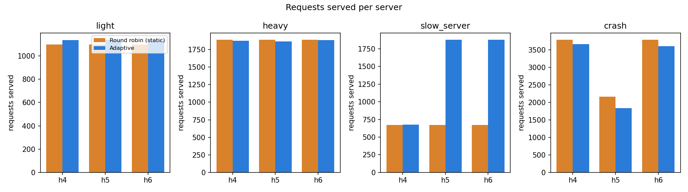
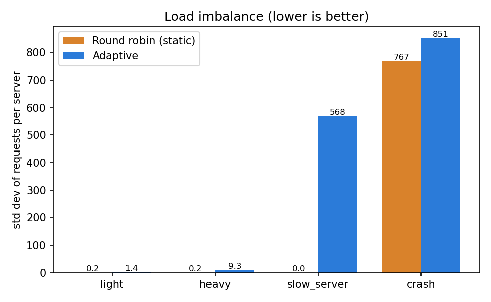

# Adaptive TCP Load Balancer using SDN

A TCP load balancer built on Mininet, Open vSwitch and a Ryu (OpenFlow 1.3) controller.
Clients send requests to one service address. The controller picks a server for every new
connection using the server's reported load, the traffic on its switch port, and whether it
is still alive. We compare it against a plain round robin controller under light load, heavy
load, a slow server and a server crash.

## The problem

Round robin gives every server the same number of connections and never looks at what the
servers are doing. If one server is slow, it still gets a third of the traffic and everyone
who lands on it waits. If one server dies, a third of the connections keep going to it and
fail. This project lets the network react to that instead: servers tell the controller how
busy they are, and the controller programs the switch accordingly.

## How it works

```
   h1      h2      h3         clients, connect to 10.0.0.100:8000
    \       |       /
     +-------------+   OpenFlow 1.3   +------------------------------+
     |  s1 (OVS)   |<---------------->|  Ryu controller              |
     +-------------+                  |  answers ARP for the service |
    /   |   |   \                     |  picks a server per connection|
  h4   h5  h6   root ns               |  installs rewrite rules      |
 servers :8000  10.0.0.254            |  tracks load and health      |
   \_____ UDP load reports -----------+------------------------------+
```

1. A client asks for the MAC of 10.0.0.100. The controller answers with a virtual MAC.
2. The first packet of a new TCP connection has no rule in the switch, so it goes to the controller.
3. The controller picks a server (see below) and installs two rules: one rewrites the destination from the service address to the chosen server, the other rewrites the replies back.
4. The rest of the connection is forwarded by the switch alone, so it stays on one server.
5. Every second each server sends its load to the controller. The controller also reads port statistics from the switch every 5 seconds.
6. A server that has been silent for 3 seconds is marked DEAD and its rules are deleted. It is taken back as soon as it reports again.

### How the adaptive controller chooses

```
score = 0.6 * (active_connections + pending) + 0.3 * (avg_response_ms / 10) + 0.1 * port_mbps
```

- DEAD servers are skipped. Servers with more than 10 connections are skipped as overloaded.
- The lowest score wins. Ties rotate between servers.
- `pending` is a +1 added the moment a connection is assigned and cleared by the next real report. Without it, a burst of connections would all pick the same "least loaded" server, because the reports are up to a second old.
- If every server is overloaded, it falls back to the lowest score. If none is alive, it still picks one and the decision log says so.
- The weights are hand-picked starting values, not tuned. They are constants at the top of `controller/adaptive_lb.py`.

The round robin controller (`roundrobin_lb.py`) has the same plumbing but takes the next server in fixed order.

## Components

| Part | Technology | What it does |
|---|---|---|
| Clients h1-h3 | Python `socket`, `threading` | Send requests, measure response time, log every request to CSV |
| Servers h4-h6 | Python `socket`, `threading` | One thread per connection, 4 worker slots, report load over UDP |
| Switch s1 | Open vSwitch | Forwards using the controller's rules |
| Controller | Ryu, OpenFlow 1.3 | Server selection, rewrite rules, health checks, failover |
| Network | Mininet | Builds the hosts, switch and links |

### Addresses

| Item | Value |
|---|---|
| Clients | h1-h3 = 10.0.0.1 - 10.0.0.3 |
| Servers | h4-h6 = 10.0.0.4 - 10.0.0.6 |
| MACs | 00:00:00:00:00:01 ... 06 |
| Switch ports | h1..h6 on ports 1..6, root namespace on port 7 |
| Service address | 10.0.0.100, TCP port 8000 |
| Controller | 127.0.0.1:6653 |
| Load reports | UDP to 10.0.0.254:9000 |

The root namespace is a link from the controller's machine into the switch. It is what lets
the servers' reports reach the Ryu process.

### What the servers and clients send

- **Client to server (TCP):** a request saying how much work to do. The server does the work
  and replies with its name and `OK`. A request costs `task_size x 10 ms` of server work.
- **Server to controller (UDP):** once a second each server sends a small status message with
  its name, how many connections it has, and its average response time. The controller uses
  this to pick servers and to notice when one has died.

Requests use TCP because every request must arrive and be answered. Status messages use UDP
because only the latest value matters: a lost one is replaced a second later, and the 3 second
timeout means two can be lost before a server is declared dead.

Each server runs 4 requests at a time and queues the rest, so response time really does grow
with load.

## Repository layout

```
controller/   roundrobin_lb.py   adaptive_lb.py
app/          server.py          client.py
topology/     topo.py            (network, fault commands, demo menu)
experiments/  run_tests.py       plot_results.py
results/      summary.csv, failover.csv and the graphs
```

## Setup

Tested on Ubuntu in a VirtualBox VM (4 CPUs). Mininet needs Linux. Ryu does not run on new
Python versions, so it gets its own Python 3.9 environment.

```bash
sudo apt install -y git curl build-essential mininet openvswitch-switch \
                    python3-pandas python3-matplotlib
sudo systemctl enable --now openvswitch-switch

curl -LsSf https://astral.sh/uv/install.sh | sh && source $HOME/.local/bin/env
uv venv --python 3.9 --seed ~/ryu-env
source ~/ryu-env/bin/activate
pip install "setuptools<58" wheel pbr eventlet==0.30.2
pip install --no-build-isolation ryu
ryu-manager --version
```

Check Mininet with `sudo mn --test pingall`.

## Running the demo

Two terminals, so the controller's decisions stay visible while you drive the network.

```bash
# Terminal 2 first. mn -c also kills any running ryu-manager, so do it before starting Ryu.
sudo mn -c

# Terminal 1: controller (round robin or adaptive)
source ~/ryu-env/bin/activate
cd ~/adaptive-lb
ryu-manager controller/adaptive_lb.py        # or controller/roundrobin_lb.py

# Terminal 2: network, servers and the menu
cd ~/adaptive-lb
sudo python3 topology/topo.py --start-servers --menu
```

| Key | Action |
|---|---|
| 1 | Normal traffic: 12 requests from h1, shows which server answered each |
| 2 | Heavy traffic: 12 parallel workers for 15 seconds |
| 3 | Slow a server (default h4, +300 ms per request) |
| 4 | Kill a server (default h5) |
| 5 | Reset: remove slowdowns, restart killed servers |
| 6 | Show the load balancer rules in the switch |
| 7 | Steps for switching between round robin and adaptive |
| q | Quit and stop the network |

To switch controller without rebuilding: Ctrl+C Ryu in Terminal 1, choose 7 and answer `y`
(this clears the old controller's rules), then start the other controller.

### Demo walkthrough

1. Round robin: press 1 (even split), 6 (rewrite rules), 3 (slow h4), 2 (split stays even, latency is high).
2. Switch to adaptive with 7.
3. Press 5 then 1 (even again, as expected with equal servers), then 3 and 2: h4's share drops and latency falls.
4. Press 4, wait a few seconds, press 1: only the two live servers answer. Press 5 and h5 comes back.

## Test cases

The `client` commands are typed at the `mininet>` prompt (press `m` in the menu, type `menu` to come back).

| Test | Expected |
|---|---|
| `pingall` | 0% dropped |
| `client h1 --vip 10.0.0.4 --requests 3` | Three replies from h4 (server works alone) |
| `client h2 --vip 10.0.0.4 --concurrency 10 --requests 5 --quiet` | 50 OK, 0 failed (concurrent connections) |
| A malformed request sent to a server | `status=ERROR`, server keeps running |
| Request to a killed server | `FAIL:ConnectionRefusedError`, client does not crash |
| 12 requests to 10.0.0.100 | Replies from h4, h5 and h6, client never sees a real address |
| Menu 6 | `set_field` rewrite rules for both directions |
| Controller log with adaptive | `[LOAD]` lines show the servers' reports arriving |
| Slow h4, then heavy traffic | Adaptive gives h4 a smaller share than round robin |
| Kill h5 | `[HEALTH] h5 ... marked DEAD`, then `ALIVE` after restart |

## Experiments

```bash
sudo mn -c
sudo python3 experiments/run_tests.py          # about 20-25 minutes
python3 experiments/plot_results.py
```

For each scenario `run_tests.py` starts the controller, builds the same network, starts the
servers, runs the same client workload on h1, h2 and h3 at once, and saves every request to
`results/raw/`. This is repeated 3 times for each controller. Only the controller changes
between the two sets of runs. `plot_results.py` averages the runs into `results/summary.csv`,
`results/failover.csv` and the graphs.

| Scenario | Workers per client | Work per request | Length | What happens |
|---|---|---|---|---|
| light | 2 | 20 ms | 20 s | Nothing, all servers healthy |
| heavy | 8 | 50 ms | 25 s | Nothing, servers are busy |
| slow_server | 6 | 30 ms | 30 s | h4 takes +150 ms per request from the start |
| crash | 4 | 30 ms | 40 s | h5 is killed at 12 s and restarted at 28 s |

Metrics: average and 95th percentile response time (successful requests only), throughput
(successful requests per second), failed requests, share of requests per server, and for the
crash scenario the time from the kill to the controller marking the server DEAD.

### Results

Averages over 3 runs. Latency covers successful requests only, because a failed request has no
response time.







- **slow_server:** adaptive sent 15% of requests to the slow server h4 (round robin: 33%), with 54% lower average latency and 119% higher throughput. Round robin keeps feeding h4 a third of the traffic, so every client that lands there waits and the whole workload slows down.
- **crash:** adaptive had 40 failed requests against 1850 for round robin. The failure was detected 2.7 s after the kill and the server was taken back 0.1 s after the restart. Round robin keeps sending a third of the connections to the dead server until it is restarted.
- **light and heavy:** with every server healthy the two are close. Average latency is within 4% in both, and no requests fail. In heavy load adaptive's 95th percentile is 21% higher, so round robin is the better choice when the servers are equal.

### Reading the graphs

- **Latency in the crash scenario.** Round robin's average latency looks slightly lower
  (47.5 ms vs 52.5 ms) because it only counts the requests that succeeded. Round robin failed
  16% of its requests and those have no response time, so they never appear in that graph. The
  failed-requests graph and the crash timeline show the full picture: adaptive answers 99.6% of
  requests, round robin 84%.
- **Requests per server in the crash scenario.** Adaptive completed about 6% fewer requests in
  total. The clients send the next request as soon as the previous one finishes, so slightly
  higher response time means slightly fewer requests per second. Round robin's higher count
  includes requests that failed immediately.
- **Load imbalance.** This graph measures how evenly requests are split. Adaptive is meant to
  send less traffic to a slow or dead server, so an uneven split in slow_server and crash is
  the intended behaviour, not a fault. Round robin scores 0 in slow_server only because it
  sends an equal share to the slow server too. In light and heavy the servers are equal and
  both controllers give each about a third.
